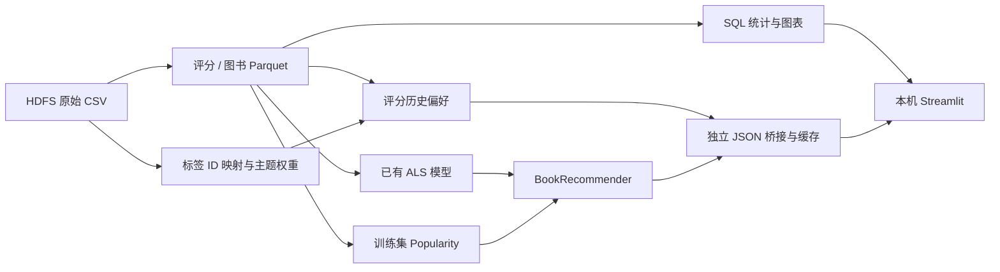

# 项目资源与访问权限

更新日期：2026-10-28（小范围加固）。认证 GitHub 连接器返回项目 `visibility=private`，当前仓库是 **Private**。通过只读 branches API 确认远端 feature 分支 SHA；未执行 fetch、commit、push 或 merge。下表未注明本次核验的环境项沿用历史封版审计，不代表本次重新安装或验证了全部外部资源；不将私网地址当作公共下载链接。

## 资源清单

| 资源 | 位置 | 当前可访问性 / 交付状态 |
| --- | --- | --- |
| 项目 GitHub | https://github.com/AliceChennnn/spark-book-recommender | **Private**；认证连接器可读，需要账号具有仓库权限，不是公共下载链接 |
| 本地 Git | feature/user-preferences，HEAD a8f3c78 | 加固开始时工作区干净；既有页面与封版材料已提交。本次加固尚未提交 |
| 远端 feature 引用 | origin 缓存与认证 branches API 均为 a8f3c78 | 检查时与本地 HEAD 一致；这是本次只读检查时点，不保证后续远端不变 |
| Goodbooks-10k | https://github.com/zygmuntz/goodbooks-10k | 未登录 API 200，visibility=public，网页公开可读 |
| 数据许可证 | 上游 LICENSE；artifacts/DATA_LICENSE.txt | CC BY-SA 4.0，已附来源；项目代码没有独立 LICENSE |
| 原始 CSV / zip | data/raw；HDFS raw | 本地被忽略；数据可从公开上游另取，本次内容有 SHA-256 |
| processed Parquet / 标签 | HDFS processed | 本地课程环境可读，未提供公共下载包 |
| ALS 权重 | HDFS models/als_full_v1 | 只在当前 HDFS 中，未导出权重 / 上传发布 |
| 模型元数据 | artifacts/metrics/model-metadata.json | 已复制小型 rank / schema 元数据，不是可加载模型权重 |
| 本机 Python 依赖 | requirements-lock.txt | 44 包的当前环境快照；需另备 OS 共享库 |
| 本地镜像 | bigdata/spark-bookrec:3.5.5 | 可 inspect，约 5.05 GB；未验证任何公共 registry 下载 |
| 教学离线归档 | ~/lab04/bigdata-spark-3.5.5-hadoop3.3.6-amd64.tar.gz | 当前约 1.7 GB，本地存在，非项目 Git 交付件；未执行导入验证其 tag 覆盖 |
| 基础 Compose | ~/lab04/compose.yaml | 仓库外，1135 字节；与 infra 覆盖文件合并校验通过 |
| HDFS 数据卷 | lab02-student_hadoop-*-data 三卷 | 当前存在，不在 Git；未备份 / 恢复演练 |
| 图表 / 演示 / 截图 | docs/artifacts | 已在 a8f3c78 跟踪，历史原始审计、实验结果和校验清单保留不变；不是运行缓存 |
| WebUI | http://192.168.142.137:8501 | 本地课程网地址，非已发布公网服务；重启后 IP 可能改变 |

公开数据来源：[Goodbooks-10k](https://github.com/zygmuntz/goodbooks-10k)、[上游 LICENSE](https://github.com/zygmuntz/goodbooks-10k/blob/master/LICENSE)。项目为 Private；课程交付需给接收者授权或另行提供经审阅的源码包，不应把仓库链接标为公共源码下载。

## 历史审计记录的解释

`docs/artifacts/environment.json` 中的未登录 API 404、`source_commit=eee13c5`、原指标、provenance 与 manifest 均保留原值；`docs/release_checklist.md` 和 `docs/artifacts/README.md` 中“仍在工作区”等文字属于当时的封版记录，不是当前 Git 状态。未登录 404 或旧连接器 404 不能推翻本次认证查询得到的 Private 状态，也不能证明仓库不存在。

后续提交已包含旧审计时尚未提交的页面和材料，因此不再将其列为交付阻塞。本次只在工作区修改覆盖保护及文档，不修改历史证据来冒充新的实验，也不自动提交。

`train_final.py` 属于页面缓存指纹输入。此次只修改入口和保存策略，未改数据划分、超参数、训练计算或已有模型；已备份运行时 `outputs/webui/demo_manifest.json`，仅刷新其代码指纹，数据版本、13 个演示条目、结果摘要与原生成时间保持不变。历史 artifacts 未重新标记版本，旧按需缓存仍保留在磁盘，但按原指纹失效。

## 模块依赖



图中的模型已在前期训练，本次不重训；标签只用于评分偏好解释，不声称增强了 ALS 模型。详尽文件列表见 README 与 release_checklist。

## 绝对路径、环境与演示代码审查

| 项目 | 发现与处理 |
| --- | --- |
| /home/bigdata/spark-book-recommender | 现有 bind mount 的主机路径；不为本轮改动集群配置 |
| /workspace/bookrec、/usr/local/spark、/usr/bin/python3 | 当前容器接口约定，已在文档说明 |
| hdfs://master:9000、spark://master:7077 | 课程 Docker 网络内地址，不能当外部浏览器链接 |
| HOME/lab04 | 启动必须的仓库外依赖，不是可省略的临时变量 |
| BOOKREC_DATA_VERSION | 页面有默认值，仅换数据 / 模型时设置并重启 |
| /tmp 浏览器库 / 字体路径 | 仅可选自动化工具，无主程序依赖；清空后需重建测试环境 |
| 660、1000、2000、661、999999 | 默认输入、演示快照白名单和验收样例；真实值由算法 / JSON 读取，不是硬编码推荐输出 |
| tests 中 FixedALSModel | 明确的测试桩，不是正式模型或真实实验结果 |
| 代理地址、调试断点、凭据 | 本轮源码 / 脚本 / 文档检索未发现代理配置、breakpoint / set_trace 或显式访问密钥；未读取或输出主机私密凭据 |

启动脚本未要求导出临时代理。宿主机原有用户网络环境不在项目配置范围，不能把未清空环境的检查称为所有网络场景验证。

## ALS 原生模型资源

路径为 hdfs://master:9000/user/root/bookrec/models/als_full_v1，存在 metadata、userFactors、itemFactors 三部分；Spark 3.5.5、rank=20。HDFS 逻辑大小 5,345,361 字节，含双副本的计费字节为 10,690,722。本次未将因子表导出到 CSV，也未修改保存模型。

仅 metadata JSON 不足以 ALSModel.load。可复现推荐还需要一致的内部 book_id 映射及完整评分历史用于已评分排除；可复现评价还需要相同评分 Parquet、INT 哈希类型和划分规则。

## 安全导出方案（仅方案，未执行）

1. 约定唯一的 outputs/exports/<批次> 目录，先检查目标不存在，记录源模型路径、Spark 版本、模型元数据、train_final.py SHA-256 和数据 CSV 校验和。
2. 只读使用 hdfs dfs -get，将完整 als_full_v1 复制到 bind mount 的新目录；不使用 -f、mv、rm 或模型 write，不直接操作 HDFS 数据卷。
3. 对复制件逐文件生成 SHA-256 清单，核对 metadata / userFactors / itemFactors 的文件数、字节及成功标志；记录导出前后源 HDFS 检查信息。
4. 在复制件上创建唯一命名 tar.gz。打包内容保留 Spark 原生目录结构、数据映射 / 版本说明与上游许可，不仅打包因子向量。
5. 操作者同意验证复制件时，用独立本地路径 ALSModel.load，只做推理并比较 660 推荐，与源模型对比；绝不 fit。
6. 对最终压缩包生成 SHA-256，明确访问权限 / 载入方法，再由作者决定是否上传 release 或课程交付盘。当前没有模型下载 URL。

示例只读复制命令，需先建好且保证目录为新批次，本次没有执行：

```bash
docker exec master hdfs dfs -get /user/root/bookrec/models/als_full_v1 \
  /workspace/bookrec/outputs/exports/<唯一批次>/als_full_v1
```

若要交付整套 HDFS 卷 / 虚拟机，应另安排一致性快照或停机窗口；不能在运行中随意压缩部分卷就声称可恢复。本阶段不执行会中断页面的方案。

## 尚未解决的交付条件

- 仓库已确认为 Private；接收者仍须被授权。本次加固工作区改动尚未提交 / 推送，旧页面与封版材料已在 a8f3c78。
- WebUI 的 8501 源地址限制目前仅有[方案](webui.md#8501-访问限制方案仅报告未应用)，尚未应用；仍无账号认证，不能将 NAT 或 CORS 当作用户权限控制。
- 模型、Parquet、教学镜像、基础 Compose 和数据卷尚未形成可公开下载的完整环境包。
- 未实际进行虚拟机重启 / 卷恢复演练；环境自启仅有人工流程。
- 调参每组历史验证日志缺失；历史封版已补齐冻结模型 RMSE 与原 Top-K 只读复测，本次不新增或重跑实验。
- 代码许可尚未选择；数据来源与许可已附，不自行为作者决定代码授权。

这些是交付范围限制，不影响当前虚拟机上的已验证业务流程。
